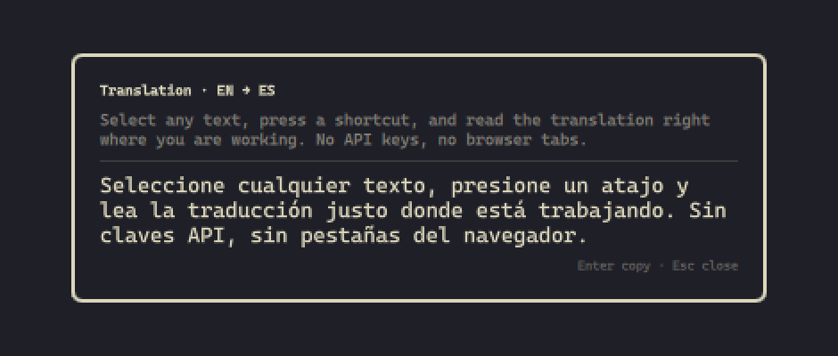

# Translate Selection para Omarchy

*[Read in English](README.md)*

Plugin para la shell de [Omarchy](https://omarchy.org/) que traduce el texto seleccionado.
Selecciona texto en cualquier aplicación, pulsa **SUPER + ALT + T** y aparece una tarjeta, con los colores de tu tema, que muestra la traducción.



- **Idioma de origen automático:** Google lo detecta.
- **Destino: español.** Si el texto ya está en español, se traduce al inglés. Puedes cambiar ambos idiomas.
- **Sin API key y sin cuenta.**
- No hace falta copiar: lee la selección primaria (lo que tienes resaltado con el ratón). Si no hay nada seleccionado, usa el portapapeles.

| Tecla | Acción |
|---|---|
| `SUPER + ALT + T` | Traducir la selección (este atajo lo añades tú) |
| `Enter` / `Ctrl + C` | Copiar la traducción y cerrar |
| `Esc` / clic fuera | Cerrar |
| `↑` `↓` / `j` `k` | Desplazar traducciones largas |

## Instalación

```bash
omarchy plugin add https://github.com/terrerovgh/omarchy-translate --enable
ln -sf ~/.config/omarchy/plugins/io.github.terrerovgh.translate-selection/bin/omarchy-translate-selection ~/.local/bin/
```

El plugin no modifica tu configuración. Añade tú el atajo en `~/.config/hypr/bindings.lua`:

```lua
o.bind("SUPER + ALT + T", "Traducir selección", os.getenv("HOME") .. "/.local/bin/omarchy-translate-selection")
```

Comprueba que no hay errores con `hyprctl reload && hyprctl configerrors`. Si `SUPER + ALT + T` ya está ocupado, elige otra combinación; puedes ver los atajos actuales con `omarchy menu keybindings --print`.

## Desinstalación

```bash
omarchy plugin remove io.github.terrerovgh.translate-selection
rm -f ~/.local/bin/omarchy-translate-selection
```

Después borra la línea `o.bind("SUPER + ALT + T", ...)` de `~/.config/hypr/bindings.lua`.

## Dependencias

- `python3` (solo biblioteca estándar) y `wl-clipboard` (`wl-paste`, `wl-copy`). Omarchy ya incluye los dos.
- Conexión a internet: usa los endpoints web públicos de Google Translate, que no necesitan clave.

## Cambiar los idiomas

En `Translate.qml`:

```qml
readonly property string targetLang: "es"   // idioma de destino por defecto
readonly property string altLang: "en"      // se usa cuando el texto ya está en targetLang
```

## Uso desde la terminal

```bash
./translate.py "Good morning"                    # {"ok": true, "source": "en", "target": "es", "text": "Buen día"}
./translate.py --to es --alt en "Buenos días"    # {"ok": true, "source": "es", "target": "en", ...}
echo "Ich habe Hunger" | ./translate.py
```

## Privacidad y seguridad

- Cada texto que traduces se envía a Google: a `clients5.google.com`, o a `translate.googleapis.com` si el primero falla. No se envía nada más y no se guarda nada.
- El texto seleccionado nunca aparece en la línea de comandos de un proceso, donde otras cuentas locales podrían leerlo en `/proc`. El launcher solo abre la tarjeta, `translate.py` lee la selección con `wl-paste` a través de un pipe, y la tarjeta le pasa el texto a `translate.py` y a `wl-copy` solo por stdin. Nada pasa por una shell.
- El resultado se muestra siempre como texto plano, así que nunca se interpreta marcado (HTML) ni en la entrada ni en la respuesta.
- La entrada se limita a 5000 caracteres y la respuesta a 1 MB, con 8 segundos de tiempo máximo.

## Licencia

[MIT](LICENSE)
