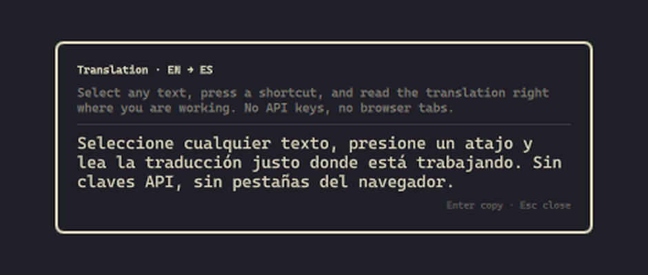

# Translate Selection for Omarchy

*[Leer en español](README.es.md)*

An [Omarchy](https://omarchy.org/) shell plugin that translates the text you have selected.
Select text in any app, press **SUPER + ALT + T**, and a card in your current theme shows the translation.



- **Source language: automatic.** Google detects it.
- **Target: Spanish.** If the text is already Spanish, it is translated to English instead. Both languages can be changed.
- **No API key, no account.**
- You don't need to copy first: it reads the primary selection, the text highlighted with the mouse, and falls back to the clipboard when nothing is selected.

| Key | Action |
|---|---|
| `SUPER + ALT + T` | Translate the selection (you add this binding) |
| `Enter` / `Ctrl + C` | Copy the translation and close the card |
| `Esc` / click outside | Close the card |
| `↑` `↓` / `j` `k` | Scroll a long translation |

## Install

```bash
omarchy plugin add https://github.com/terrerovgh/omarchy-translate --enable
ln -sf ~/.config/omarchy/plugins/io.github.terrerovgh.translate-selection/bin/omarchy-translate-selection ~/.local/bin/
```

The plugin does not change your configuration. Add the key binding yourself in `~/.config/hypr/bindings.lua`:

```lua
o.bind("SUPER + ALT + T", "Translate selection", os.getenv("HOME") .. "/.local/bin/omarchy-translate-selection")
```

Check it with `hyprctl reload && hyprctl configerrors`. If `SUPER + ALT + T` is already taken, pick another key. To see current bindings, run `omarchy menu keybindings --print`.

## Uninstall

```bash
omarchy plugin remove io.github.terrerovgh.translate-selection
rm -f ~/.local/bin/omarchy-translate-selection
```

Then delete the `o.bind("SUPER + ALT + T", ...)` line from `~/.config/hypr/bindings.lua`.

## Dependencies

- `python3` (standard library only), `wl-clipboard` (`wl-paste`, `wl-copy`) and `jq`. Omarchy ships all three.
- An internet connection. Translation uses Google Translate's public, keyless web endpoints.

## Change the languages

Edit `Translate.qml`:

```qml
readonly property string targetLang: "es"   // default target language
readonly property string altLang: "en"      // used when the text is already in targetLang
```

## Command-line use

```bash
./translate.py "Good morning"                    # {"ok": true, "source": "en", "target": "es", "text": "Buen día"}
./translate.py --to es --alt en "Buenos días"    # {"ok": true, "source": "es", "target": "en", ...}
echo "Ich habe Hunger" | ./translate.py
```

## Files

| File | Purpose |
|---|---|
| `manifest.json` | Plugin manifest (`overlay`) |
| `Translate.qml` | The overlay card (Quickshell) |
| `translate.py` | Translator, Python standard library only |
| `bin/omarchy-translate-selection` | Reads the selection and opens the plugin through `omarchy-shell` |
| `i18n/` | Interface strings (`en`, `es`) |

## Privacy and security

- Every text you translate is sent to Google: `clients5.google.com`, with `translate.googleapis.com` as a fallback. Nothing else is sent, and nothing is stored.
- The selected text goes to the translator as a process argument and is never run through a shell.
- Translations are always shown as plain text, so markup in the input or the response is not rendered.
- Input is limited to 5000 characters and responses to 1 MB, with an 8-second timeout.

## License

[MIT](LICENSE)
